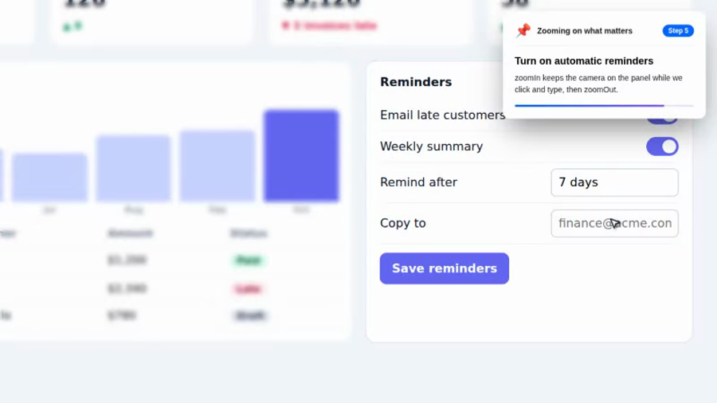
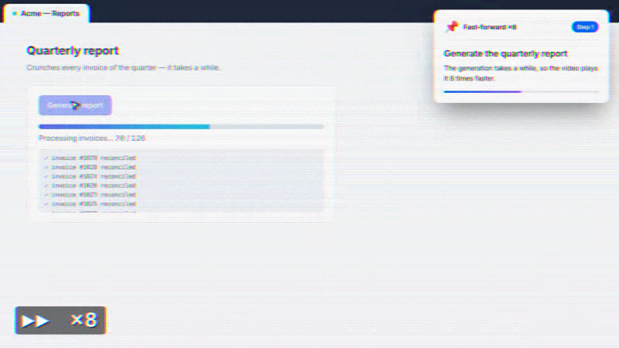
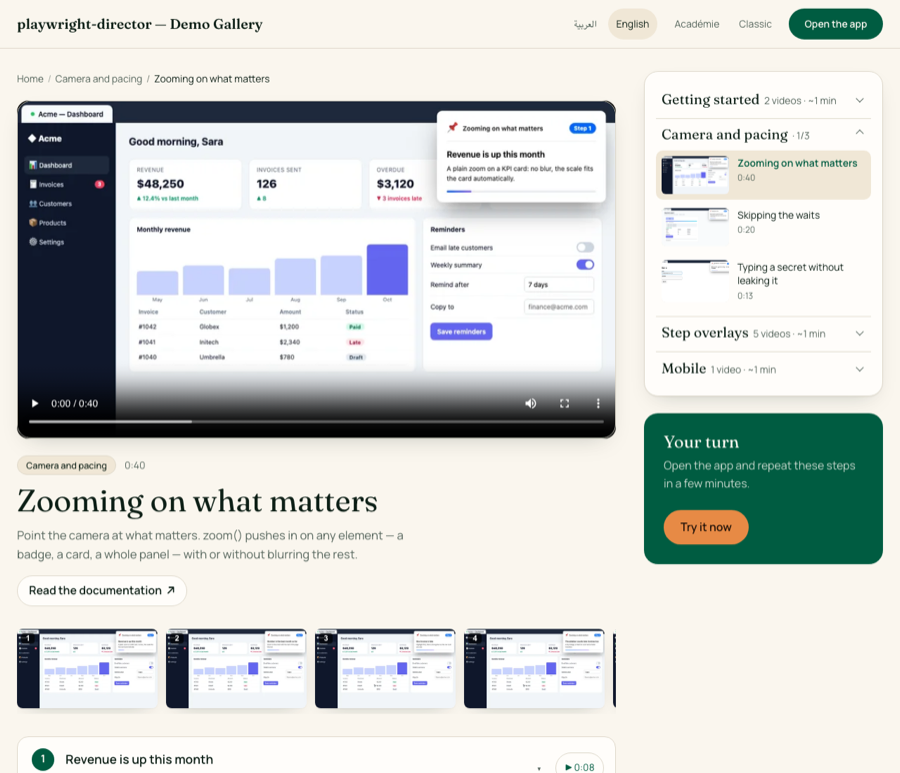
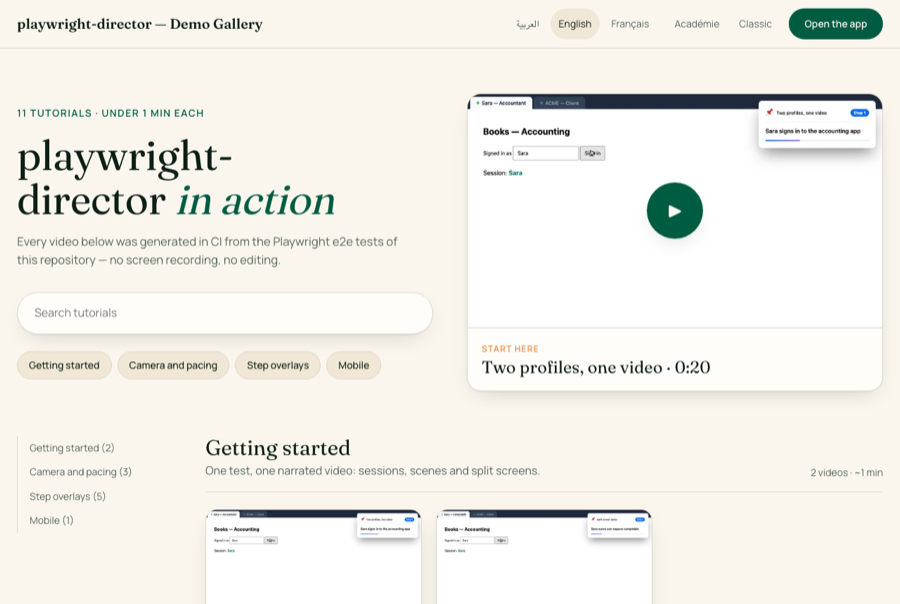
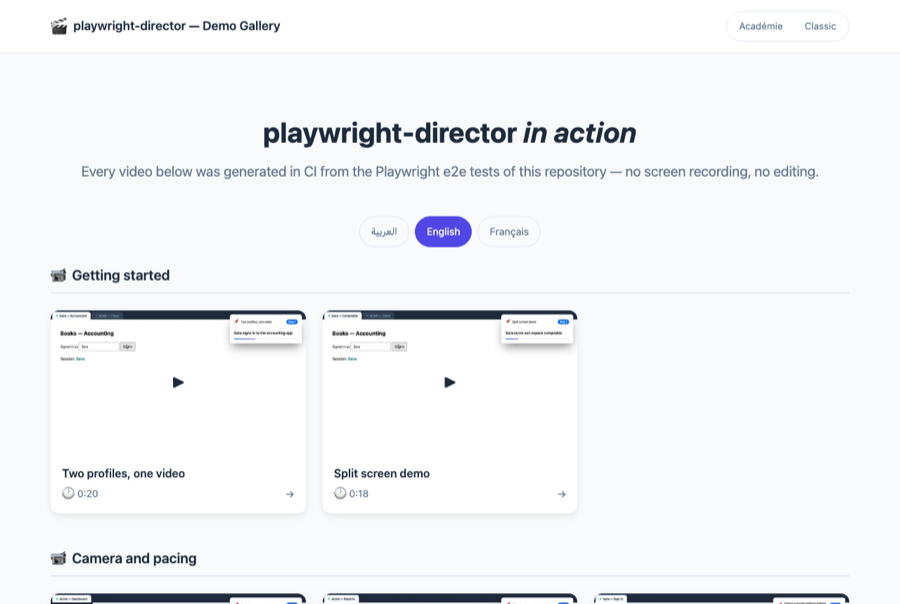
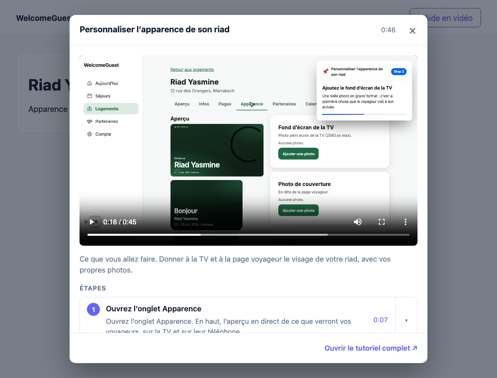

# playwright-director

**Turn your Playwright end-to-end tests into directed video guides — automatically.**

Write your tests once, get polished how-to videos with voice narration, animated cursor, step overlays, background music, and ffmpeg post-processing. Publish them as a static gallery site, and embed any tutorial back into your app as contextual help with a single `data-tutorial` attribute. No screen-recording software, no video editors, no docs that lag behind the product.

An AI agent can also write or adapt the test for a specific communication goal — a product demo, a feature explanation, an onboarding walkthrough — and the direction is yours to apply: what to emphasize, how fast to move, where to pause. Every demonstration stays reproducible, because it originates from an automated test.

🌐 **[Project site](https://youniwemi.github.io/playwright-director/)** · 🎬 **[Live demo gallery](https://youniwemi.github.io/playwright-director/gallery/)** — every gallery video is recorded by this repo's own CI from its e2e tests on each push to `main`.

---

## Table of Contents

- [Why playwright-director?](#why-playwright-director)
- [The name](#the-name)
- [Installation](#installation)
- [Quick Start](#quick-start)
- [API Reference](#api-reference)
  - [Zooming on an element](#zooming-on-an-element)
  - [Fast-forwarding long waits](#fast-forwarding-long-waits)
- [Multiple user profiles](#multiple-user-profiles)
- [Variants — record the same tutorial for mobile](#variants--record-the-same-tutorial-for-mobile)
- [TTS Configuration](#tts-configuration)
- [Environment Variables](#environment-variables)
- [Styling](#styling)
- [Output Files](#output-files)
- [Reviewing & Correcting Narration](#reviewing--correcting-narration)
- [Claude Code Integration](#claude-code-integration)
- [Tutorial Gallery Site](#tutorial-gallery-site)
  - [Themes](#themes)
  - [In-app help widget](#in-app-help-widget)
  - [Deploying to GitHub Pages from CI](#deploying-to-github-pages-from-ci)
- [How It Works](#how-it-works)
- [License](#license)

---

## Why playwright-director?

Most software teams maintain **tests** and **documentation** separately. Tests verify features work; docs explain how to use them. When a feature changes, the docs lag behind — or never get updated.

`playwright-director` bridges this gap: your Playwright tests **are** your tutorial source. Run them normally for CI; flip a flag and they produce broadcast-ready **directed video guides**.

### Key Features

- **Dual-mode tests** — Same test file runs as a fast E2E test (`playwright test`) or a narrated video tutorial (`TUTORIAL_MODE=true`)
- **Voice narration** — Built-in TTS with macOS `say`, Microsoft Edge TTS, or any custom command via `TUTORIAL_TTS_CMD`
- **Animated cursor** — Smooth, eased mouse movements with click animations that follow your test actions
- **Step overlays** — On-screen banners showing current step, progress bar, and descriptions
- **Context screens** — Goal / clarification / attention cards between steps to explain what's happening
- **Background music** — Looping audio with fade-out on completion
- **Camera zoom** — `zoom()` pushes in on a button, a field or a whole panel, optionally blurring the rest, then zooms back out
- **Fast-forward** — `fastForward(speed, …)` plays a slow generation or a repetitive chore sped up in the final video, VHS-style (`▶▶ ×4` badge, scanlines, tape grain)
- **Blurred secrets** — `typeBlurred()` types passwords and API keys into a field that stays blurred in the video
- **Email previews** — Simulated email popups for verification flow demos
- **Multiple user profiles** — Two signed-in personas as browser-like tabs in one video, with an optional side-by-side moment
- **ffmpeg post-processing** — Automatic video + audio merge with timeline-accurate voice placement
- **Screenshot capture** — WebP screenshots at each step, poster image from step 1
- **Transcript generation** — Markdown transcripts auto-generated from timeline data
- **Multi-language** — Full RTL support (Arabic), per-language video filenames, i18n-ready
- **Playwright Reporter** — Auto-merges audio into video as each tutorial test completes
- **Gallery site** — `build-site` turns your recordings into a static video gallery with step-by-step guides, ready for any static host
- **Two site themes** — Académie (editorial: hero, search, sections, course sidebar) or Classic (card grid); design tokens, extra CSS or file overrides for your brand
- **SEO built in** — VideoObject JSON-LD with chapters, `sitemap.xml` with hreflang, canonical and Open Graph tags
- **App and docs links** — each video links to the matching screen of your app and page of your docs
- **In-app help widget** — the published gallery serves a `widget.js`: one `data-tutorial` attribute opens any tutorial as an overlay inside your own app
- **Zero runtime overhead** — All tutorial logic is no-op when `TUTORIAL_MODE` is not set

## The name

This package went through more names than it went through versions. It started as `pw-tutorial-video` — literal, honest, and about as charming as a filename. It worked until the tool outgrew it: this package no longer just records videos, it stages them — deciding what to emphasize, how fast to move, where to pause, what deserves the viewer's attention.

Then came the search, and the search was humbling. `tutorialize` — the most natural verb in the space — was taken. `testory` (test + story) was brandable but told you nothing. `test2video` described the mechanics, not the craft. `playwright-tutorial` was accurate and instantly forgettable. Every candidate either over-explained or under-sold.

The way out was to flip the question: stop naming the output, name the role. Playwright is the actor — it performs every click, scroll, and keystroke on stage. This package is everything around the performance: the staging, the pacing, the narration, the final cut. That job already has a name — **director**. `playwright-director` was free, and it was the only candidate that described the job instead of the file format.

## Installation

```bash
npm install --save-dev playwright-director
```

### Peer Dependencies

| Package | Required | Notes |
|---|---|---|
| `@playwright/test` | Yes | >= 1.40.0 |
| `sharp` | Optional | For optimized WebP screenshots (falls back to raw PNG) |
| `ffmpeg` | Runtime | Required on PATH for audio/video merge |
| `ffprobe` | Runtime | Required on PATH for audio duration detection |

## Quick Start

### 1. Create a tutorial-enabled test

```typescript
import { test, expect } from '@playwright/test';
import { Tutorial } from 'playwright-director';

test('Create your first invoice', { tag: ['@tutorial'] }, async ({ page }, testInfo) => {
  const tutorial = new Tutorial(page, {
    title: 'Create Your First Invoice',
    lang: 'en',
    audioBaseUrl: 'http://localhost:5173',  // your dev server port
    backgroundMusic: '',                    // or a URL to a .mp3 file
    // Required for the reporter to match and merge the video:
    testTitle: testInfo.title,
    testFile: testInfo.file,
    projectName: testInfo.project.name,
  });

  // Add a context screen (goal explanation)
  tutorial.context('invoice.intro', {
    text: 'Learn how to create and send your first invoice',
    style: 'goal',
  });

  // Add steps — actions are queued, not executed yet
  tutorial.step('invoice.client', async () => {
    await tutorial.click(page.getByLabel('Client'));
    await tutorial.selectOption(page.getByLabel('Client'), 'Acme Corp');
  }, {
    do: 'Select your client',
    explain: 'Choose from your existing client list or create a new one',
  });

  tutorial.step('invoice.amount', async () => {
    await tutorial.fill(page.getByLabel('Amount'), '1500');
  }, {
    do: 'Enter the invoice amount',
  });

  tutorial.step('invoice.send', async () => {
    await tutorial.click(page.getByRole('button', { name: 'Send' }));
    await expect(page.getByText('Invoice sent')).toBeVisible();
  }, {
    do: 'Send the invoice',
    explain: 'Your client will receive the invoice by email',
  });

  // Execute all steps and finalize the video
  await tutorial.complete('Invoice created successfully!');
});
```

### 2. Run as a normal test

```bash
npx playwright test --grep "@tutorial"
```

### 3. Run in tutorial mode (generates video)

```bash
TUTORIAL_MODE=true npx playwright test --grep "@tutorial"
```

Videos are saved to `tutorials/videos/`, timelines to `tutorials/output/`.

> **Important**: Never override `--reporter` on the CLI for tutorial runs — it disables the merge step. Use the config file instead.

### 4. Add generated paths to `.gitignore`

Tutorial runs create files in your project. Add these to `.gitignore`:

```gitignore
# playwright-director generated files (the voice cache is tutorials/.cache/voice)
tutorials/
```

The narration clips are cached in `tutorials/.cache/voice/` (`TUTORIAL_VOICE_DIR`
changes it). They stay out of your app's `static/` or `public/` folder, so they
never ship in its production build: during the recording Playwright serves
them to the page itself. Upgrading from 0.4: clips found in the old
`static/audio/tutorial-voice/` are copied into the new cache the first time
they are needed, so nothing is re-synthesized; delete the old folder after a
run.

### 5. Converting an existing test

The most common use case is converting an existing Playwright test:

| Before (plain test) | After (tutorial) |
|---|---|
| `await page.click(...)` | `await tutorial.click(...)` |
| `await page.fill(...)` | `await tutorial.fill(...)` or `tutorial.typeSlowly(...)` |
| `await page.selectOption(...)` | `await tutorial.selectOption(...)` |
| — | `tutorial.context(...)` between sections |
| — | `tutorial.step(title, action, { do, explain })` wrapping groups |
| — | `await tutorial.complete(message)` at the end |

Keep the `expect()` assertions — they still run in both modes, ensuring your tutorial stays in sync with the real UI.

## API Reference

### `Tutorial` class

```typescript
import { Tutorial } from 'playwright-director';

const tutorial = new Tutorial(page, options);
```

#### `TutorialOptions`

| Option | Type | Default | Description |
|---|---|---|---|
| `title` | `string` | *required* | Tutorial title shown in overlay |
| `translate` | `(key: string) => string` | `k => k` | Translation function — pass your i18n `t()` |
| `audioBaseUrl` | `string` | `'http://localhost:5173'` | Origin the narration audio plays from (Playwright serves the clips; any page origin works) |
| `lang` | `string` | `'en'` | Language for UI text and TTS (e.g. `'en'`, `'fr'`, `'ar'`) |
| `testName` | `string` | auto | Output filename slug |
| `testFile` | `string` | `''` | Test file path for metadata |
| `projectName` | `string` | `''` | Playwright project name |
| `enableVoice` | `boolean` | `true` | Enable TTS voice narration |
| `voiceName` | `string` | auto | TTS voice name |
| `voiceRate` | `number` | `1.0` | Speech rate multiplier |
| `backgroundMusic` | `string` | `''` | Music file URL |
| `musicVolume` | `number` | `0.15` | Background music volume (0-1) |
| `voiceVolume` | `number` | `2.5` | Voice volume multiplier |
| `stepDelay` | `number` | `500` | Delay before the action for non-voiced steps (ms). Voiced steps overlap narration and action instead: the action starts at the estimated end of the `do` sentence inside the clip (25% of the clip for single-phase steps), and the step lasts `max(narration, offset + action)` |
| `mouseSteps` | `number` | `25` | Cursor animation smoothness |
| `customStyles` | `string` | built-in | Custom CSS for overlays |
| `scenes` | `Record<string, SceneOptions>` | — | Named scenes for multi-profile tutorials — see [Multiple user profiles](#multiple-user-profiles) |
| `focus` | `string \| string[]` | first scene | Scene(s) active when the stage mounts |
| `sceneTransition` | `{ duration?: number }` | `{ duration: 600 }` | Pause on a scene switch (ms) |

#### Methods

| Method | Description |
|---|---|
| `context(key, options?)` | Add a context screen (goal/clarification/attention) |
| `step(key, action, options?)` | Add a tutorial step with an action callback |
| `complete(message?)` | Execute all queued steps and finalize |
| `click(locator)` | Click with cursor animation and highlight |
| `fill(locator, value)` | Fill input with highlight |
| `typeSlowly(locator, value, delay?)` | Type character by character (visual effect) |
| `typeBlurred(locator, value, options?)` | Type a secret into a field that stays blurred — options `{ delay?: 50, blur?: 4 (px), reveal?: false }` (or a number = `delay`). The blur is **not** removed afterwards unless `reveal: true` |
| `unblur(locator)` | Remove the blur left by `typeBlurred()` |
| `selectOption(locator, value)` | Select dropdown option with highlight |
| `highlight(locator, duration?)` | Highlight an element |
| `zoom(locator, options?)` | Camera zoom on an element, hold, zoom back out — see [Zooming on an element](#zooming-on-an-element) |
| `zoomIn(locator, options?)` / `zoomOut()` | Zoom in and stay zoomed (interact while zoomed), then zoom back out |
| `startFastForward(speed, options?)` / `endFastForward()` | Mark the start / end of a span played `speed`× faster in the final video — see [Fast-forwarding long waits](#fast-forwarding-long-waits) |
| `fastForward(speed, action, options?)` | Run `action` fast-forwarded (start + end markers around it) and return its result |
| `moveMouseToElement(locator)` | Animate cursor to element |
| `showEmailPreview(options)` | Show simulated email popup |
| `switchPage(page)` | Switch recording to another tab/window |
| `clearFields()` | Clear form fields on next page load |
| `stage()` | Mount the multi-scene stage (tab bar + one iframe per scene) |
| `scene(name)` | Get a scene as a Playwright `FrameLocator` |
| `goto(name, url)` | Navigate a scene (relative to its `baseUrl`, or absolute) |
| `focus(name \| names[])` | Bring scene(s) on stage — one fills it, two share it |

### `StepOptions`

| Option | Type | Description |
|---|---|---|
| `do` | `string` | Short action text shown in overlay |
| `explain` | `string` | Explanation played during/after action |
| `voiceText` | `string` | Custom TTS text (overrides do/explain) |
| `skipVoice` | `boolean` | Skip voice for this step |
| `description` | `string` | Description shown below step title |
| `delay` | `number` | Custom delay after this step (ms) |
| `scene` | `string \| string[]` | Scene(s) this step plays on — the stage switches before the action runs |

### `ContextOptions`

| Option | Type | Description |
|---|---|---|
| `text` | `string` | Description shown below title |
| `style` | `'goal' \| 'clarification' \| 'attention'` | Visual style |
| `voiceText` | `string` | Custom TTS text |

### Zooming on an element

`zoom()` pushes the camera in on an element — a button, a form field, a whole
card or panel — holds, then zooms back out. Optionally the rest of the page is
blurred. The step banner and cursor stay crisp and in place: only the page
zooms.

```typescript
tutorial.step('The Pro plan', async () => {
  await tutorial.zoom(page.locator('#pro-plan'), { blur: true });
});

// Stay zoomed while acting — clicks and the cursor work in the zoomed view
tutorial.step('Pick it', async () => {
  await tutorial.zoomIn(page.locator('#pick-pro'));
  await tutorial.click(page.locator('#pick-pro'));
  await tutorial.zoomOut();
});
```



| Option | Type | Default | Description |
|---|---|---|---|
| `scale` | `number` | auto | Zoom factor. Auto fits the element to ~70% of the viewport, capped at 2.5× (never below 1× — a huge element just gets the blur) |
| `duration` | `number` | `1500` | `zoom()` only: how long to hold the zoomed view (ms) |
| `blur` | `boolean \| number` | `false` | Blur and slightly dim everything but the element. `true` = 4px, a number sets the radius |
| `transition` | `number` | `600` | Duration of each zoom-in / zoom-out animation (ms) |

The zoom stays "reasonable": the view never pans past the page edge, so an
element near a corner stays off-center instead of revealing blank canvas.
It works across scenes (the whole stage zooms) and on scrolled pages with
fixed headers. Like the rest of the tutorial layer, it is a no-op when
`TUTORIAL_MODE` is off. Keep a `zoomIn()`/`zoomOut()` pair inside one step.

### Fast-forwarding long waits

Some flows have a stretch nobody wants to watch in real time: a report that
takes 30 seconds to generate, a twelve-row form filled one field at a time.
Mark it with a start and an end marker and the final video plays it sped up,
like fast-forwarding an old VHS tape — a `▶▶ ×N` badge, scanlines and a
rolling tracking band in the page, tape grain and a chroma shift added by
ffmpeg. The test itself still runs at normal speed: only the video is
re-timed.

```typescript
tutorial.step('Generate the quarterly report', async () => {
  await tutorial.click(page.locator('#generate'));
  // Wrap the slow part — speed is the argument
  await tutorial.fastForward(8, async () => {
    await expect(page.locator('#report')).toBeVisible({ timeout: 60_000 });
  });
});

// Or with explicit markers
tutorial.step('Import the twelve invoices', async () => {
  await tutorial.startFastForward(4);
  for (const row of rows) await tutorial.fill(page.locator(`#amount-${row.id}`), row.amount);
  await tutorial.endFastForward();
});
```



| Option | Type | Default | Description |
|---|---|---|---|
| `speed` (argument) | `number` | — | Playback speed of the span in the final video. Must be `> 1` |
| `vhs` | `boolean` | `true` | VHS look (badge, scanlines, grain, chroma shift). `false` = a plain speed-up |

A video can have any number of spans, each with its own speed — e.g. a
report generation at `4` and a PDF export at `8` in the same tutorial.

The final length is predictable: each span of `L` ms recorded at speed `S`
lasts `L / S` ms in the video, so the video is `tape − Σ L × (1 − 1/S)` long.
The timeline JSON records it — `totalDurationMs` is the final length,
`tapeDurationMs` the recorded one, `fastForward[]` the spans — and step
timestamps, transcripts and the gallery all use final-video time.

Rules:

- Call it **inside a step's action** (it needs the running timeline of
  `complete()`). A span never outlives its step — one left open is closed as soon as the step's action returns.
- Narration is never sped up. If the step's narration is still playing,
  `startFastForward()` waits for the clip to end first, so the voice never
  runs over sped-up video.
- No-op outside `TUTORIAL_MODE` (`fastForward()` just runs the action).

## Multiple user profiles

Some stories need two people: an accountant issues an invoice, a client pays it.
Declare each one as a **scene** and the stage becomes a browser-like tab bar,
with one `<iframe>` per scene.

```typescript
const tutorial = new Tutorial(page, {
  title: 'Invoice, end to end',
  testTitle: 'invoice issued then paid',
  audioBaseUrl: 'http://localhost:5173',
  scenes: {
    accountant: { label: 'Sara — Accountant', baseUrl: 'http://localhost:5173' },
    client:     { label: 'ACME — Client',     baseUrl: 'http://localhost:5174' },
  },
  focus: 'accountant',
});

const accountant = tutorial.scene('accountant'); // a Playwright FrameLocator
const client     = tutorial.scene('client');

await tutorial.stage();
await tutorial.goto('accountant', '/invoices/new');
await tutorial.goto('client', '/login');

tutorial.step('The accountant issues the invoice',
  () => tutorial.click(accountant.getByRole('button', { name: 'Issue' })),
  { scene: 'accountant' });

tutorial.step('The client pays it',
  () => tutorial.click(client.getByRole('button', { name: 'Pay now' })),
  { scene: 'client' });          // the stage switches tabs on its own

tutorial.step('Both sides, at once',
  () => expect(accountant.getByText('Paid')).toBeVisible(),
  { scene: ['accountant', 'client'] });   // side by side, just for this step

await tutorial.complete();
```

### How it behaves

- **Sessions are independent** because each scene is a separate **origin**. Two
  iframes on the same origin share cookies and `localStorage`, so the second
  login overwrites the first. For two users of the *same* app, serve it under a
  second hostname (`app.localhost` / `app2.localhost`) to get a second origin.
- **Inactive scenes stay mounted**, hidden but never unloaded — a profile logged
  in behind another tab is still logged in when you come back to it.
- **A hidden scene is not interactive.** Pass `scene` on every step that touches
  one; the stage switches before the action runs. Acting on an off-stage scene
  will simply time out.
- **`scene: [a, b]` puts two scenes side by side**, each taking half the stage.
  Treat it as an exception for the moment cause and effect must share one frame:
  at 1280px wide, each pane only gets ~640px. In an array, the first scene is
  the one acting.
- **Tabs are always all visible**, so the viewer knows who else is in the story
  and who is speaking now.
- Each timeline step records its `scene`, so transcripts say who was on screen.

### Requirements

- Target pages must allow framing. Sites sending `X-Frame-Options: SAMEORIGIN`
  or `DENY` (Google, Bing, many SaaS apps) **cannot** be used as scenes. For
  your own app, relax `frame-ancestors` in tutorial mode only.
- `stage()` navigates the parent page to `audioBaseUrl` before injecting the
  stage, so narration audio loads same-origin (Playwright answers the voice
  URLs from the cache; the app does not need to serve them).

## Languages — one spec, one recording per language

Run the same spec once per language with `TUTORIAL_LANG`. It overrides the
`lang` option (narration + TTS voice: macOS Thomas / Samantha / Majed, Edge
Henri / Guy / Hamed, or your `TUTORIAL_TTS_CMD` with `{lang}`) and suffixes
every output with `.<lang>`. Drive the app UI and your texts from
`tutorial.lang`:

```typescript
const tutorial = new Tutorial(page, { title: t('look.title'), testName: 'look', lang: 'fr', translate: t });
await page.goto(`/properties/1/look?lang=${tutorial.lang}`);  // app UI in the recorded language
```

```bash
TUTORIAL_MODE=true npx playwright test tutorial                    # → look.webm (default, lang option)
TUTORIAL_MODE=true TUTORIAL_LANG=en npx playwright test tutorial   # → look.en.webm
TUTORIAL_MODE=true TUTORIAL_LANG=ar npx playwright test tutorial   # → look.ar.webm
```

The gallery groups the recordings by slug (`look`). It gets one home page per
language — `/` for the site's default `lang`, `/en/`, `/ar/`… for the others,
linked to each other — each video page links to the same tutorial in the other
languages, and Arabic/Hebrew/Persian/Urdu pages render right-to-left. The site
chrome (buttons, labels) is translated in English, French and Arabic; see
`strings` in the site configuration to change a text or add a language.
Embed data: `embed/<slug>.<lang>.json` per language, `embed/<slug>.json` =
the default language (or the only one recorded), and `index.json` lists each
slug once with its `langs`. `load(slug, { lang })` falls back to the default
language when that language was not recorded.

## Variants — record the same tutorial for mobile

Set `TUTORIAL_VARIANT=mobile` (or pass `variant: 'mobile'`) to record a second,
phone-sized version of a tutorial without touching the spec:

```typescript
import { Tutorial, mobileStage } from 'playwright-director';

// Widens the viewport (and video) to N phones side by side.
// Inert unless TUTORIAL_VARIANT=mobile — the same spec records both versions.
test.use(mobileStage(2)); // default device 'Pixel 7'; or mobileStage(2, 'iPhone 14'), or an explicit {width, height}

const tutorial = new Tutorial(page, { /* options unchanged */ });
```

```bash
TUTORIAL_MODE=true npx playwright test                          # → tutorials/videos/<name>.webm
TUTORIAL_MODE=true TUTORIAL_VARIANT=mobile npx playwright test  # → tutorials/videos/<name>-mobile.webm
```

What the `mobile` variant does automatically:

- **Suffixes every output** with `-mobile` (video, timeline, transcript,
  screenshots, poster) so the desktop version is never overwritten.
- **Pins the split** on multi-scene tutorials: every phone stays visible at
  equal width for the whole video, the tab bar never shows, per-scene labels
  take over (the inactive one is dimmed), and `focus()` ratios are ignored —
  on phone-width panes an asymmetric split has no room to work.
- **Compacts the overlay**: smaller card, smaller type, icon and step badge
  hidden. It is all CSS variables scoped under `html[data-tutorial-variant='mobile']`
  remapping to `--tutorial-*-mobile` values, so tuning it is a plain `:root`
  override from your own styles (see [Styling](#styling)):

```css
:root {
  --tutorial-overlay-width-mobile: 220px;
  --tutorial-icon-display-mobile: inline-flex; /* bring the icon back */
}
```

Any other variant name (`TUTORIAL_VARIANT=tablet`) only suffixes the outputs
and stamps `data-tutorial-variant` — no preset. The reporter matches each run
to the timeline of the same variant, so both runs can share
`TUTORIAL_OUTPUT_DIR`, and the gallery site gains a Desktop/Mobile filter when
variants are present.

Note: `mobileStage()` must be passed to `test.use()` at the top of the spec —
the video size is frozen when the browser context is created.

### Sharp mobile video (oversampling)

Playwright records video at *window* pixels and never upscales, so a
phone-sized viewport would yield a blurry ~400px-wide video. In tutorial mode,
`mobileStage()` therefore records **oversampled 2× by default**: it launches
Chromium with `--force-device-scale-factor=2`, aligns `deviceScaleFactor`, and
doubles the video size — the page layout (CSS viewport) is unchanged, a Pixel 7
video comes out at 824×1678.

```typescript
test.use(mobileStage(2, 'Pixel 7', { scale: 3 })); // even sharper
test.use(mobileStage(2, 'Pixel 7', { scale: 1 })); // old behavior, native CSS pixels
```

Caveat: `test.use()` replaces the config's `launchOptions` wholesale. If your
playwright.config passes Chromium args for tutorial runs (e.g.
`--autoplay-policy=no-user-gesture-required`), repeat them via `launchArgs`:

```typescript
test.use(mobileStage(2, 'Pixel 7', {
  launchArgs: ['--autoplay-policy=no-user-gesture-required'],
}));
```

### Playwright Reporter

Auto-merge audio into video after each tutorial test:

```typescript
// playwright.config.ts
export default defineConfig({
  reporter: [
    ['playwright-director/reporter', {
      mappingFile: 'path/to/tutorial-mapping.txt',  // optional
      tutorialsJson: 'path/to/tutorials.json',      // optional
    }],
  ],
});
```

### Utilities

```typescript
import { slugify } from 'playwright-director/slugify';
import { createTTSProvider } from 'playwright-director';
import { buildMergeCommand } from 'playwright-director';
```

## TTS Configuration

### macOS (default)

Uses the built-in `say` command. Voices per language:
- French: Thomas
- English: Samantha
- Arabic: Majed

### Edge TTS

Free Microsoft neural voices. Install: `pip install edge-tts`

### Custom TTS

Set `TUTORIAL_TTS_CMD` with placeholders:

```bash
# Custom voice engine
TUTORIAL_TTS_CMD='my-tts --voice premium -l {lang} {text} -o {output}'
```

### Pre-rendering the voice cache

TTS synthesis is the slow part of a tutorial run, and clips are cached by
`md5(lang:text)` — the hash covers the **text only**, so a voice or
`TUTORIAL_TTS_CMD` change never invalidates old clips. `regen-voices` generates
the clips outside of any test run:

```bash
npx playwright-director regen-voices                    # synthesize the missing clips
npx playwright-director regen-voices --workers=4        # parallel TTS (default 2)
npx playwright-director regen-voices --force            # after a voice change: redo everything
npx playwright-director regen-voices --lang=fr          # one language only
rm -rf tutorials/.cache/voice && npx playwright-director regen-voices   # full rebuild
```

Narration texts are collected from the artifacts that record them verbatim:
the transcripts (`tutorials/transcripts/*.md`) and the timelines
(`tutorials/output/*_timeline.json`). The project `.env` is loaded for the
`TUTORIAL_*` settings. Videos are not remixed — the next `TUTORIAL_MODE=true`
run picks the clips up from cache.

## Environment Variables

| Variable | Default | Description |
|---|---|---|
| `TUTORIAL_MODE` | `false` | Enable tutorial video generation |
| `TUTORIAL_VARIANT` | none | Recording variant — suffixes outputs; `mobile` also compacts the overlay and pins the split |
| `TUTORIAL_VOICE_DIR` | `tutorials/.cache/voice` | Voice clip cache (read by recording, merge and `regen-voices`) |
| `TUTORIAL_LANG` | none | Recording language — overrides `lang`, suffixes outputs `.<lang>` (one run per language) |
| `TUTORIAL_VOICE` | `true` | Enable/disable voice narration |
| `TUTORIAL_VOICE_NAME` | auto | TTS voice name override |
| `TUTORIAL_TTS_CMD` | `say` (macOS) | Custom TTS command |
| `TUTORIAL_OUTPUT_DIR` | `tutorials/output` | Timeline output directory |
| `TUTORIAL_MUSIC` | none | Background music file URL |
| `TUTORIAL_MUSIC_VOLUME` | `0.15` | Background music volume |
| `TUTORIAL_VOICE_VOLUME` | `2.5` | Voice narration volume |
| `TUTORIAL_MAPPING_FILE` | none | Tutorial-to-video mapping file |
| `TUTORIAL_TUTORIALS_JSON` | none | Tutorials metadata JSON |

## Styling

Import the default styles or provide your own:

```typescript
// Use default styles (automatic)
const tutorial = new Tutorial(page, { title: 'My Tutorial' });

// Use custom styles
const tutorial = new Tutorial(page, {
  title: 'My Tutorial',
  customStyles: '.tutorial-overlay { background: navy; }'
});
```

CSS variables for theming:

```css
:root {
  --tutorial-primary: #3b82f6;
  --tutorial-bg-start: rgba(30, 41, 59, 0.95);
  --tutorial-border: rgba(148, 163, 184, 0.3);
  --tutorial-text: #f8fafc;
  --tutorial-z-index: 10000;
  --tutorial-animation-duration: 0.3s;

  /* Multi-scene stage */
  --tutorial-stage-bg: #1e293b;
  --tutorial-scene-bg: #ffffff;
  --tutorial-tab-bg: #334155;
  --tutorial-tab-text: #94a3b8;
  --tutorial-tab-bg-active: #f8fafc;
  --tutorial-tab-text-active: #0f172a;
  --tutorial-tab-dot: #64748b;
  --tutorial-tab-dot-active: #22c55e;
  --tutorial-tab-padding: 10px 20px;
  --tutorial-tab-radius: 10px 10px 0 0;
  --tutorial-tab-size: 15px;
  --tutorial-tab-transition: 250ms;
  --tutorial-stage-gap: 2px;
  --tutorial-tabbar-padding: 8px 8px 0;
}
```

Scene panes deliberately expose no size variables: they share the stage evenly
via flexbox, and animating that sizing makes Playwright treat the frame as never
stable, which times out every click inside it.

## Output Files

After running in tutorial mode:

```
tutorials/
├── output/
│   └── {test-name}_timeline.json    # Step timing + ffmpeg command
├── transcripts/
│   └── {test-name}.md               # Auto-generated transcript
└── videos/
    ├── {test-name}.webm             # Merged video with audio
    ├── {test-name}-poster.webp      # Poster image (step 1)
    └── {test-name}-step-{n}.webp    # Step screenshots
```

## Reviewing & Correcting Narration

Every tutorial run auto-generates a markdown transcript in
`tutorials/transcripts/{test-name}.md`. To rework the narration, edit the
transcript and write the corrections back into your test source:

```bash
# 1. (Optional) regenerate transcripts from the timeline JSON files
npx tutorial-transcript

# 2. Edit tutorials/transcripts/{test-name}.md — fix the narration texts

# 3. Apply: rewrites the corrected texts in your test file
npx tutorial-transcript apply tutorials/transcripts/{test-name}.md

# 4. Re-record only that tutorial (-g matches the test title); only the
#    changed TTS clips are regenerated (content-hash caching)
TUTORIAL_MODE=true npx playwright test -g "Customize the look"

# 5. Preview just that page (a site with only this tutorial)
npx playwright-director build-site -y --only={test-name}
```

Example — the transcript line `Cliquez sur Enregistrer.` corrected to
`Cliquez sur « Enregistrer » pour valider.` becomes, after `apply`, the same
change in the `tutorial.step(…)` string of the spec file.

`apply` pairs each transcript entry with its timeline step (by the `**key:**`
lines, in order — a key used twice corrects each occurrence in turn; the
`**[Complete]**` entry is the completion message), then locates the original
text in the test file (`testFile` from the timeline) as a quoted string
literal and replaces it. A narration composed of two fields
(`do` + `explain`, or title + `description`/`text`) is handled by splitting
old and new text at the first sentence boundary and replacing both halves.

What `apply` **won't** touch: texts that come from an i18n catalog (the
literal isn't in the test file) and step keys rendered verbatim as titles —
those are reported with their key so you can fix the translation instead.
The timeline JSON is updated on success, so re-running `apply` is a no-op.

`npx tutorial-transcript apply [file.md ...]` limits the run to specific
transcripts; without arguments it processes every `.md` in the transcript
directory (`TUTORIAL_TRANSCRIPT_DIR`, default `tutorials/transcripts`).

## Claude Code Integration

This package ships **two assets for Claude Code** that teach AI agents how to convert your Playwright tests into professional tutorials:

### What you get

| Asset | Installed to | Purpose |
|---|---|---|
| `/tutorialize` skill | `.claude/skills/tutorialize/` | Slash command that loads tutorial design methodology — persona analysis, storytelling arc, choreography rules, and the full `playwright-director` API. Invoke with `/tutorialize` in Claude Code. |
| `tutorial-crafter` agent | `.claude/agents/tutorial-crafter.md` | Specialized agent (Sonnet) that reads your test, designs the tutorial arc, and writes the tutorial code. Dispatched automatically or manually. |

### Skill reference files

The skill bundles three reference documents that Claude reads before tutorializing:

| File | Content |
|---|---|
| `SKILL.md` | 4-phase process: understand the viewer → design the arc → implement with `playwright-director` → verify |
| `references/storytelling.md` | Who is watching (role, expertise, emotional state), narration voice rules, pacing decisions, when to use context screens vs steps, multi-profile scene heuristics, directing attention (highlight vs camera zoom vs blur, secrets typed blurred) |
| `references/api.md` | Complete `Tutorial` class API with timing model, critical rules (e.g., navigate before any tutorial call, never override `--reporter`), camera zoom options and rules, and a pre-commit checklist |
| `references/site.md` | Gallery site configuration: every `tutorial-site.config.js` option, themes, sections and order, tokens → css → overrides, app/docs links, languages, CLI flags, output files |

### Setup

```bash
npx playwright-director init
```

This interactively copies the skill and agent into your `.claude/` directory. Example session:

```
  playwright-director 0.2.0 — Claude Code Setup

  Install /tutorialize skill into .claude/skills/? [Y/n] y
  + Skill copied to .claude/skills/tutorialize/
  Install tutorial-crafter agent into .claude/agents/? [Y/n] y
  + Agent copied to .claude/agents/tutorial-crafter.md

  Done! You can now use /tutorialize in Claude Code.
```

### Usage in Claude Code

```
# Ask Claude to convert a test into a tutorial
> Tutorialize tests/free/01_company.init.ts

# Or invoke the skill directly
> /tutorialize tests/premium/10_expense-scan.test.ts
```

Claude will:
1. Read the test and identify the viewer persona
2. Design a storytelling arc (goal → steps → completion)
3. Write the tutorial code with `tutorial.context()`, `tutorial.step()`, voice narration text, camera zooms on the key moments, and `tutorial.complete()`
4. Verify the test still passes in both normal and tutorial mode

### Keeping them up to date

The skill and agent are **copies**, so upgrading the package does not auto-update them.
`init` stamps the version it installed in `.claude/.playwright-director.json`, and:

- after an upgrade, a post-install message names what went stale and tells you to
  re-run `init` — it only speaks when there is something to say, and never writes
  to `.claude/` on its own;
- re-running `init` shows the transition (`0.1.0 → 0.2.0`) and skips anything
  already current;
- `npx playwright-director init --yes` answers yes to everything, for scripted
  updates.

If you customize the copied skill, keep your additions in a separate file next to
it — `init` overwrites, it does not merge.

## Tutorial Gallery Site

Generate a static video gallery website from your tutorials — one command, zero config.

### Quick start

```bash
npx playwright-director build-site
```

On the first run, a `tutorial-site.config.js` file is created with sensible defaults. Edit it to customize branding, then re-run `build-site` — the config is reused automatically.

The command scans your `tutorials/` directory for videos, screenshots, and timeline metadata, then builds a static site ready to deploy (e.g., to Cloudflare Pages, Netlify, or any static host).

Astro, which renders the site, is playwright-director's own dependency: your project does not need it, and the build works in npm, pnpm and bun workspaces (including bun's isolated linker).

### What gets generated

```
tutorial-site-dist/          # Static site output (configurable)
├── index.html               # Gallery home — videos grouped by category
├── {video-slug}/index.html  # Dedicated page per video: player + step-by-step guide
├── widget.js                # Embeddable in-app help widget (see below)
├── client.js                # Headless data API (ESM) — widget.js builds on it
├── embed/                   # Widget data
│   ├── {video-slug}.json    # One payload per tutorial: video, description, steps
│   └── index.json           # All available slugs (discovery/debugging)
├── sitemap.xml              # Full baseUrl only: every page with its hreflang alternates
├── robots.txt               # Full baseUrl at the host root only
├── links.json               # Docs URL → tutorials that link to it (show "watch the video" in your docs)
└── videos/                  # Copied from tutorials/videos/
    ├── *.webm               # Video files
    └── *-step-*.webp        # Step screenshots (carousel on cards, guide on video pages)
```

### Video pages & the step guide

Each video page shows the player, the tutorial's intro narration as a
description, and a **step-by-step guide** built from the timeline: every step's
narration text paired with its screenshot. Context narrations recorded
mid-flow appear as callouts between steps, and steps recorded without voice
still show their text.

Each voiced step also shows its start time (`▶ 0:13`): clicking it seeks the
video there, and the step that is playing is highlighted (`aria-current="step"`).
Seeking needs a host that answers HTTP Range requests with `206` — Cloudflare
Pages, Netlify and GitHub Pages do. `?t=<seconds>` in the page URL starts the
video there. A step
declared with an untranslated key (`tg.open`) is titled with the first
sentence of its narration instead.



Two settings control the guide (`tutorials` block of the config):

| Setting | Values | Effect |
|---|---|---|
| `showStrip` | `true` (default) / `false` | Horizontal thumbnail strip under the video info. Clicking a thumbnail opens the screenshot in a lightbox with the step's number, title and text as a caption. |
| `stepsLayout` | `'text'` (default) | Text-only cards — clicking a step reveals its screenshot inline. |
| | `'cards'` | Numbered cards with a small screenshot; click opens the lightbox. |
| | `'full'` | Narration text + full-width screenshot under each step. |
| | `'none'` | No step guide (strip only, if enabled). |

| `stepsLayout: 'cards'` | Strip thumbnail clicked → lightbox with caption |
|---|---|
|  |  |

<details>
<summary><code>stepsLayout: 'full'</code> — full-width screenshot per step</summary>


</details>

### Themes

Two themes share the same pages and data. Pick one with `theme` in the config
(or `build-site --theme=classic`):

| `theme: 'academy'` (default) | `theme: 'classic'` |
|---|---|
|  |  |
| Hero with search and section chips, a featured "start here" video, a side table of contents, numbered cards (thumbnail = quick view, title = page), a course sidebar and a "your turn" call-to-action on video pages | Card grid grouped by section, dark mode, a thumbnail carousel per card |

Brand it with the lightest layer that does the job:

1. **`tokens`** — colors, radius, shadow and fonts become `--pd-*` CSS variables
   (`primary onPrimary accent bg surface text muted border pro radius shadow shadowHover fontBody fontDisplay`;
   an unknown name fails the build). `googleFonts` loads the families you name (`false` = none).
2. **`css`** — a stylesheet loaded after the theme.
3. **`overrides`** — a folder copied over the site `src/` after the theme: replace any page,
   component or theme file (`theme/Home.astro`, `components/VideoCard.astro`, …).

To offer both looks, build twice and link the builds with `themeSwitcher`
(the demo gallery does this: [Académie](https://youniwemi.github.io/playwright-director/gallery/) ·
[Classic](https://youniwemi.github.io/playwright-director/gallery/classic/)).

**App and docs links.** Declare where a tutorial belongs in the test — `new Tutorial(page, { links: { app: '/invoices/new', docs: '/invoices/' } })` —
or per slug in `tutorials.links`. Paths are resolved on `appUrl` / `docsUrl` (`{lang}` is replaced by the
tutorial language). The video page shows "Open in the app" / "Read the documentation", and the Académie
call-to-action opens the app.

**SEO.** With a full `baseUrl` (`https://…`), every page gets a canonical URL, hreflang alternates and
Open Graph tags; video pages carry a schema.org `VideoObject` (chapters as `Clip`s, `uploadDate` from the
recording). The build writes `sitemap.xml`, `robots.txt` (host root only) and `links.json`. A bare-path
`baseUrl` skips the absolute URLs.

The full option reference is [`skills/tutorialize/references/site.md`](skills/tutorialize/references/site.md).

### In-app help widget

The published gallery doubles as a documentation backend for your app. Every
build ships a `widget.js` at the site root plus one JSON payload per tutorial
under `embed/`. Load the script from your deployed gallery and mark any
element with `data-tutorial="<video-slug>"`:

```html
<script src="https://tutorials.myapp.com/widget.js" defer></script>

<button data-tutorial="create-account">📘 How does this work?</button>
```

Clicking the element opens a modal dialog right inside your app — the tutorial
video, its intro narration and its chapters (click a chapter to jump to it in
the video; the playing one is highlighted), with a link to the full tutorial
page on the gallery:



Notes:

- **Zero dependencies, framework-agnostic** — clicks are handled by event
  delegation, so buttons added later (React/Vue re-renders) work without
  re-initialization. Styles live in a shadow root and can't leak either way;
  the widget inherits your app's font.
- **Slugs** are the video ids — the file names in the gallery's `videos/`
  directory (a tutorial's `name`, plus `-<variant>` for variant recordings).
  `GET <site>/embed/index.json` lists them all.
- **Programmatic API**: `window.PlaywrightDirector.open('create-account', { lang: 'fr' })`
  and `window.PlaywrightDirector.close()` — e.g. to launch a tutorial from an
  onboarding checklist instead of a button. `load()` returns the data with no
  UI (see the next section).
- **Language**: `open()`'s `lang`, else the trigger's `data-tutorial-lang`,
  else your page's `<html lang>`. It picks the tutorial language (falling back
  to the default one) and the widget texts — English, French and Arabic are
  built in; add one from your page with
  `PlaywrightDirector.strings.es = { close: 'Cerrar', steps: 'Pasos', … }`.
  Arabic, Hebrew, Persian and Urdu render right-to-left.
- **Accessibility**: a native modal `<dialog>` — the page behind is inert, Esc
  or a click on the backdrop closes it, focus goes to the labelled close
  button and returns to the trigger afterwards. Chapters are a list of
  buttons (`aria-current="step"` on the playing one; ↑/↓, Home/End move
  between them, Enter seeks); every target is at least 44 px. The e2e suite
  runs axe (WCAG 2.1 AA) on the open dialog in French and Arabic.
- **Theming**: set CSS custom properties on the widget host from your app's
  stylesheet — your rules win over the defaults:

  ```css
  .playwright-director-widget {
    --pd-accent: #16a34a;        /* default: the gallery's primaryColor */
    --pd-surface: #ffffff;       /* dialog background */
    --pd-text: #0f172a;
    --pd-muted: #64748b;         /* secondary text */
    --pd-border: #e2e8f0;
    --pd-radius: 12px;
    --pd-font: "Inter", sans-serif;  /* default: your app's font */
    --pd-focus-ring: 0 0 0 3px rgb(22 163 74 / 45%);  /* a box-shadow */
  }
  ```

  The pre-0.5 `--playwright-director-accent` still works.
- **Cross-origin**: the widget loads `client.js` and `embed/<slug>.json` from
  the gallery host, so the gallery must send `Access-Control-Allow-Origin` for
  your app's origin. GitHub Pages sends `*` out of the box; for Cloudflare
  Pages and Netlify, `build-site` writes a `_headers` file (see
  [Deploying to Cloudflare Pages](#deploying-to-cloudflare-pages)).

### Headless data API — bring your own player

Apps with their own player or dialog read the same data with no UI.

**Script tag** (with `widget.js` loaded):

```js
const t = await window.PlaywrightDirector.load('create-account', { lang: 'fr' });
```

**Bundled ESM** (no script tag):

```js
import { load, loadIndex, currentStep } from 'playwright-director/client';

const t = await load('create-account', { baseUrl: 'https://tutorials.myapp.com/', lang: 'fr' });
video.src = t.video;                       // absolute URL
for (const s of t.steps) if (s.at !== undefined) addChapter(s.at, s.title);
video.ontimeupdate = () => highlight(currentStep(t.steps, video.currentTime));
```

`load()` resolves to the payload of `embed/<slug>.json` with **every URL made
absolute** (`video`, `poster`, `page`, `steps[].image`) plus `baseUrl`. With
`lang`, it tries `embed/<slug>.<lang>.json` first and falls back to the default
language. It rejects with a message that names the URL and the reason
(unknown slug → HTTP 404 and the index URL; network/CORS failure → the missing
`Access-Control-Allow-Origin` header).

The payloads are versioned: [`schemas/embed-v1.schema.json`](schemas/embed-v1.schema.json)
(also importable as `playwright-director/schemas/embed-v1.schema.json`).
In the raw files, all paths are **relative to the site base URL** (the
directory serving `widget.js` and `embed/`).

| `embed/<slug>.json` field | Meaning |
|---|---|
| `schemaVersion` | `1` — only gains optional fields; a breaking change bumps it |
| `id`, `title`, `description?`, `lang`, `variant?` | Identity and intro narration |
| `duration` / `durationSeconds` | `"m:ss"` display string / number |
| `video`, `poster?`, `page` | Video, poster image, full gallery page |
| `steps[]` | `{ num?, at?, title?, key?, text?, image?, context? }` — `at` = start in seconds (chapters), `title` = human heading, `key` = the i18n key, `context: true` = unnumbered narration |

`embed/index.json` is `{ schemaVersion, tutorials: [{ id, title, duration, durationSeconds, lang, variant? }] }`.

### Configuration

```js
// tutorial-site.config.js
export default {
  // Branding (see Themes above)
  title: "My App Tutorials",       // Site title (header + page titles)
  logo: "./assets/logo.svg",       // Path to logo image (optional)
  theme: "academy",                // 'academy' (default) | 'classic'
  tokens: { primary: "#0f766e", radius: "12px", fontBody: "Inter, sans-serif" },  // --pd-* variables
  googleFonts: ["Inter:wght@400;600"],  // Optional: fonts to load (false = none; default: the theme's)
  css: "./tutorials/site.css",     // Optional: extra stylesheet, after the theme
  overrides: "./tutorials/site/",  // Optional: folder copied over the site src/
  themeSwitcher: { Académie: "/help/", Classic: "/help/classic/" },  // Optional: links between builds
  // primaryColor / font: pre-0.6 spellings of tokens.primary / tokens.fontBody, still read

  // Links (optional)
  appUrl: "https://app.myapp.com",          // Resolves links.app; header button + call-to-action
  docsUrl: "https://docs.myapp.com/{lang}", // Resolves links.docs
  cta: true,                                // Académie "your turn" panel (needs an app link)

  // Paths
  input: "tutorials/",             // Where videos + timelines live
  output: "tutorial-site-dist/",   // Where the static site is built (may sit inside input)
  timelines: "e2e/output/",        // Optional: timeline JSON dir (default <input>/output — match TUTORIAL_OUTPUT_DIR)
  videos: "e2e/videos/",           // Optional: videos + screenshots dir (default <input>/videos)

  // Site
  baseUrl: "https://tutorials.myapp.com",  // Full URL, or just a path ("/help/") for a sub-path deployment
  cors: "*",                               // _headers Access-Control-Allow-Origin: "*", one origin, or false (no file)
  lang: "fr",                              // Default language (served at /, others at /<lang>/)
  strings: {                               // Optional: site UI texts, merged over the built-in en/fr/ar
    fr: { allTutorials: "Toute l’aide" },
    es: { allTutorials: "Todos los tutoriales", close: "Cerrar" },  // a new language starts from English
  },

  // Content overrides (optional)
  tutorials: {
    categories: {          // Sections in display order; `items` = slugs in reading order
      "getting-started": { icon: "⭐", label: "Getting Started", blurb: "The first ten minutes", items: ["sign-up", "first-invoice"] },
      "advanced":        { icon: "🚀", label: "Advanced" },
    },
    featured: "sign-up",              // Académie "start here" video (default: the first one)
    premium: ["bank-reconciliation"], // PRO badge
    links: { "first-invoice": { app: "/invoices/new", docs: "/invoices/" } },  // Over the test's `links`
    ui: {
      heroTitle: "Learn My App",
      heroSubtitle: "Step-by-step video tutorials",
    },
    stepsLayout: "text",   // Step guide on video pages: 'text' | 'cards' | 'full' | 'none'
    showStrip: true,       // Thumbnail strip above the guide (click = lightbox + caption)
  },
};
```

### How videos are discovered

The scanner looks for `.webm` files in `<input>/videos/` (or `videos`). For each video:

- If a matching `_timeline.json` exists in `<input>/output/` (or `timelines`), its metadata is used (title from narration steps, duration, category from `@feature:*` tag)
- Otherwise, a human-readable title is derived from the filename and duration is left blank

Step screenshots (`{video}-step-{n}.{png,webp}`) are auto-detected and displayed as a carousel on each video card.

### Previewing locally

The generated site uses relative paths, but browsers block `<video>` elements on `file://`. Use any static server:

```bash
npx serve tutorial-site-dist
```

### CLI options

```bash
playwright-director build-site                      # Uses ./tutorial-site.config.js
playwright-director build-site --config=path/to.js   # Custom config path
playwright-director build-site --base=/help/         # Deploy under a sub-path (overrides baseUrl)
playwright-director build-site -y                    # Never prompt (CI); also automatic without a TTY
playwright-director build-site --only=look,billing   # Only these tutorials (all languages/variants)
playwright-director build-site --theme=classic       # Override the config theme
playwright-director build-site --output=site-classic/  # Override the output folder
playwright-director build-site --dev                 # Serve with live reload (astro dev) instead of building
```

`--only` builds a site with just those tutorials — handy to check one page
quickly. Deploy a full build.

### Deploying to Cloudflare Pages

Publish the output directory as is. It contains a `_headers` file (also read
by Netlify) so that an app on another origin can load the tutorials:

```
/embed/*      Access-Control-Allow-Origin: *   Cache-Control: public, max-age=300
/client.js    Access-Control-Allow-Origin: *   Cache-Control: public, max-age=300
/widget.js    Access-Control-Allow-Origin: *   Cache-Control: public, max-age=300
/videos/*     Access-Control-Allow-Origin: *   Cache-Control: public, max-age=604800
```

Set `cors` in the config to one origin (`"https://app.example.com"`) to
restrict it, or `false` to write no file. With a sub-path (`--base=/help/`)
the rules are prefixed with it. Videos keep their name when re-recorded, so
their cache is one week, not "immutable".

Seeking a video (chapters, the player's timeline) needs a host that answers
HTTP Range requests with `206 Partial Content`. Cloudflare Pages, Netlify and
GitHub Pages do; some simple static servers (`python -m http.server`) do not.

### Deploying to GitHub Pages from CI

The gallery is a plain static site, so it deploys anywhere — this repository deploys its own on every push to `main` ([`.github/workflows/deploy-site.yml`](.github/workflows/deploy-site.yml)): a marketing landing page at the site root and the generated gallery under `/gallery/`.


The workflow, in short:

```yaml
on:
  push:
    branches: [main]

steps:
  - uses: actions/checkout@v4
  - uses: actions/setup-node@v4
    with: { node-version: 22, cache: npm }
  - run: npm ci
  - run: sudo apt-get update && sudo apt-get install -y ffmpeg
  - run: pipx install edge-tts                     # real narration on Linux
  - run: npx playwright install --with-deps chromium
  - run: npm run test:e2e:video                    # TUTORIAL_MODE=true playwright test
  - run: npx playwright-director build-site -y
  - run: |                                         # same gallery, Classic theme (optional)
      npx playwright-director build-site -y --theme=classic \
        --base=/playwright-director/gallery/classic/ --output=tutorial-site-classic/
  - run: |                                         # landing page + galleries
      mkdir -p _site/gallery/classic
      cp -r landing/. _site/
      cp -r tutorial-site-dist/. _site/gallery/
      cp -r tutorial-site-classic/. _site/gallery/classic/
  - uses: peaceiris/actions-gh-pages@v4
    with:
      github_token: ${{ secrets.GITHUB_TOKEN }}
      publish_dir: ./_site
```

Things to know when adapting it:

- **TTS on Linux** — there is no macOS `say` on CI runners. With [`edge-tts`](https://pypi.org/project/edge-tts/) on the PATH the voice system falls back to it automatically, so the published videos have real narration. Alternatively set `TUTORIAL_TTS_CMD` to any command you prefer.
- **Sub-path hosting** — GitHub Pages serves project sites under `/<repo>/`. Set `baseUrl` in `tutorial-site.config.js` to the full public URL **including the path** (this repo uses `https://youniwemi.github.io/playwright-director/gallery/`); the site build derives the Astro `site` + `base` from it so all links and assets resolve.
- **Pages source** — the workflow publishes to the `gh-pages` branch; configure Pages (Settings → Pages) to serve from that branch.
- Skip the landing-page assembly step and publish `tutorial-site-dist/` directly if you only want the gallery at the site root.

## How It Works

1. **Test registration** — `tutorial.step()` / `tutorial.context()` queue actions and start preloading TTS audio in background
2. **Execution** — `tutorial.complete()` waits for all TTS preloads, then executes steps sequentially with overlays, cursor animation, and voice playback
3. **Timeline** — Each step records its timestamp and audio file reference
4. **Post-processing** — The Playwright reporter reads the timeline JSON, waits for Playwright to finalize the video file, then runs ffmpeg to merge the silent screen recording with the voice clips and background music

## License

MIT
